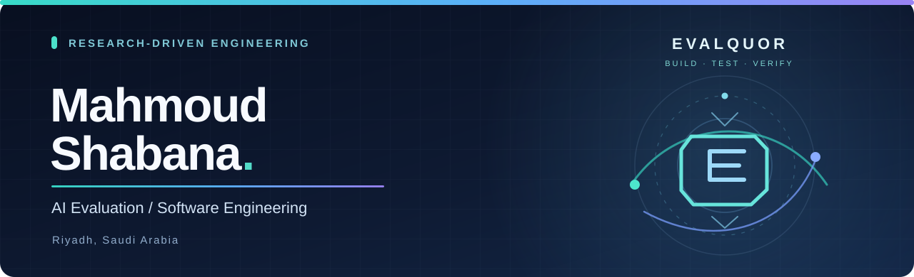

<strong>تقييم نماذج الذكاء الاصطناعي · الأنظمة الوكيلة · هندسة البرمجيات</strong>

<a href="./README.md">English</a> · <a href="https://github.com/Mahmoud-Shabana?tab=repositories">جميع المستودعات</a>

---

### هندسة مبنية على الدليل

أنا **محمود شبانة**، أعمل على تقاطع **تقييم النماذج اللغوية، وموثوقية الوكلاء البرمجيين، والاختبارات القابلة لإعادة الإنتاج، وأدوات المطورين**. أهتم بتحويل المسائل التقنية الصعبة إلى مواصفات واضحة، واختبارات قابلة للقياس، وبرمجيات يمكن التحقق من سلوكها.

أعمل كذلك على تطوير **EVALQUOR**، وهو مشروع يركز على التقييم المتخصص للذكاء الاصطناعي، والمعايير المرجعية، وأدوات البرمجيات العملية.

**منهجي:** تحديد المشكلة ← تصميم اختبار مستقل ← قياس النتائج ← تحسين النظام.

### أعمال مختارة

| المشروع | المجال | الحالة |
| :--- | :--- | :--- |
| [VoxRubric](https://github.com/Mahmoud-Shabana/voxrubric) | تقييم ومقارنة أنظمة المقابلات والوكلاء الصوتيين، مع دعم العربية والإنجليزية | إصدار Alpha |
| [PatchProof AI](https://github.com/Mahmoud-Shabana/PatchProof-AI-Risk-Adaptive-Verification-for-Coding-Agents) | التحقق التكيفي من التغييرات البرمجية التي تنفذها وكلاء الذكاء الاصطناعي | مشروع بحثي |
| [BreakMyApp](https://github.com/Mahmoud-Shabana/breakmyapp) | فحص جودة المواقع محليًا باستخدام Chromium وتجميع أدلة قابلة للمراجعة | نسخة تجريبية للمطورين |
| [TypeForge Studio](https://github.com/Mahmoud-Shabana/typeforge-studio) | أداة مكتبية لإدخال النصوص وUnicode والاختصارات والمقاطع المحفوظة | مشروع موجّه لويندوز |

**ومن أعمال هندسة الأنظمة:** [توثيق تشغيل OpenCore وmacOS Sequoia على HP ZBook Fury 17 G7](https://github.com/Mahmoud-Shabana/HP-ZBook-Fury-17-G7-OpenCore-Sequoia).

> بعض هذه المستودعات نماذج بحثية أو نسخ تجريبية، وليست منتجات إنتاجية مكتملة. يُرجى مراجعة ملف README داخل كل مشروع لمعرفة ما تم اختباره وما لا يزال قيد التطوير.

### المهارات والأدوات

`Python` · `TypeScript` · `JavaScript` · `Docker` · `Playwright` · `Git` · `GitHub Actions` · `Linux` · `SQL`

### مجالات التعاون

أرحب بالتعاون في **تقييم الذكاء الاصطناعي، وهندسة الاختبارات المعيارية، والأنظمة الوكيلة، والأدوات مفتوحة المصدر**. للتواصل بشأن مشروع محدد، يمكن استخدام قسم Issues في المستودع المرتبط.

<strong>ابنِ ما يمكن اختباره، ووثّق ما يمكن إعادة إنتاجه.</strong>

EVALQUOR · الرياض، السعودية · العربية والإنجليزية

