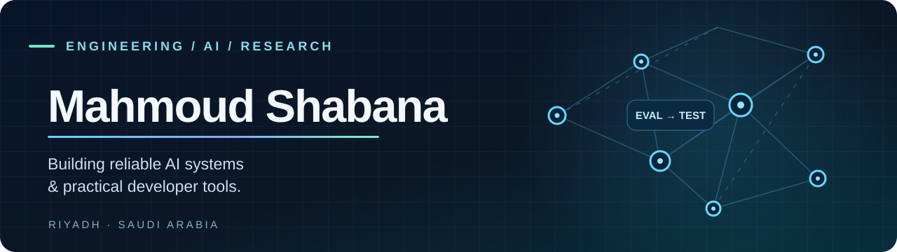

  

  
<strong>AI Research & Evaluation · Software Engineering · Open Source</strong>

  
From difficult AI evaluation problems to reproducible tests and useful software.

  
  
  

---

### Hello, I'm Mahmoud 👋

I work at the intersection of **AI evaluation, software engineering and research tooling**. I enjoy turning complex problems into **reproducible benchmarks, testable software and evidence-backed results** — especially for LLMs, coding agents and developer workflows.

My approach: **clear requirements → measurable tests → careful implementation → honest limitations.**

- 🔬 **AI evaluation:** LLM assessment, agentic workflows, rubrics and regression testing.
- 🛠️ **Engineering:** Python and TypeScript tools, automated tests, containers and CI workflows.
- 🛡️ **Reliability:** risk-aware verification, software quality, security-minded design and reproducibility.
- 🤝 **Collaboration:** open to remote engineering and AI evaluation projects.

### Selected work

<table>
<tr>
<td width="50%" valign="top">
<h3><a href="https://github.com/Mahmoud-Shabana/voxrubric">📊 VoxRubric</a></h3>

Provider-neutral evaluation and regression tooling for AI interview and voice agents, with evidence-grounded metrics and Arabic/English support.

<code>Python</code> <code>AI Evaluation</code> <code>Benchmarking</code>

</td>
<td width="50%" valign="top">
<h3><a href="https://github.com/Mahmoud-Shabana/PatchProof-AI-Risk-Adaptive-Verification-for-Coding-Agents">🛡️ PatchProof AI</a></h3>

An experimental risk-adaptive approach to verifying AI-generated code changes, with an emphasis on reproducible evaluation and safer patch decisions.

<code>Python</code> <code>Coding Agents</code> <code>Verification</code>

</td>
</tr>
<tr>
<td width="50%" valign="top">
<h3><a href="https://github.com/Mahmoud-Shabana/breakmyapp">🧪 BreakMyApp</a></h3>

A local-first website quality scanner using real Chromium runs to surface responsive issues, JavaScript failures, broken resources and reviewable evidence.

<code>TypeScript</code> <code>Playwright</code> <code>Web QA</code>

</td>
<td width="50%" valign="top">
<h3><a href="https://github.com/Mahmoud-Shabana/HP-ZBook-Fury-17-G7-OpenCore-Sequoia">💻 OpenCore on HP ZBook</a></h3>

An evidence-led macOS compatibility and troubleshooting journal: hardware findings, graphics/backlight diagnostics, reproducible fixes and known limitations.

<code>OpenCore</code> <code>Diagnostics</code> <code>Documentation</code>

</td>
</tr>
</table>

> **Project transparency:** Some repositories are research prototypes, alpha versions or developer previews. Each project's README is the source of truth for supported features and limitations.

### Toolkit

### Activity & collaboration

GitHub's built-in contribution calendar and public activity are displayed directly below this README. For code, documentation and ongoing experiments, browse the [public repositories](https://github.com/Mahmoud-Shabana?tab=repositories) and their issue trackers.

---

  <strong>Good engineering is measurable. Good research is reproducible.</strong> 
  Interested in AI evaluation, open-source software or developer tooling? Explore a repository, open an issue or start a discussion.

