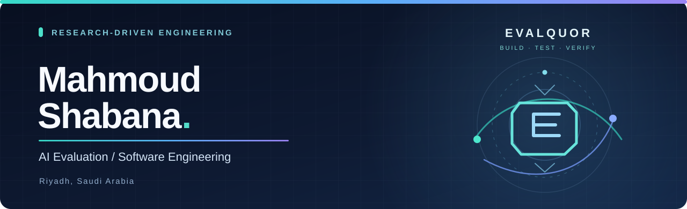
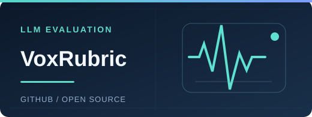
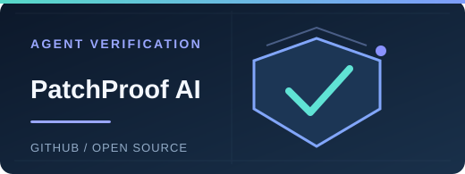
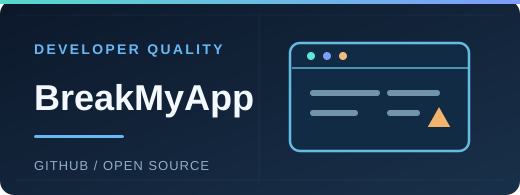
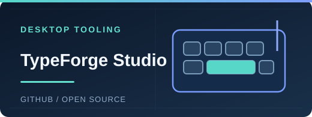

  <strong>AI Evaluation</strong> &nbsp; · &nbsp;
  <strong>Agentic Systems</strong> &nbsp; · &nbsp;
  <strong>Software Engineering</strong>

  <a href="./README.ar.md">العربية</a> &nbsp; · &nbsp;
  <a href="https://github.com/Mahmoud-Shabana?tab=repositories">All repositories</a>

---

### Engineering with evidence.

I'm **Mahmoud Shabana**, a software engineer focused on **LLM evaluation, coding-agent reliability, reproducible benchmarks, and developer tools**. I work across research and implementation: specifying hard problems, designing measurable tests, building systems, and documenting what has *actually* been verified.

I'm also developing **EVALQUOR**, a project focused on expert-led AI evaluation, benchmarking, and practical software tooling.

**My approach:** define the failure mode → build an independent test → measure the result → improve the system.

### Selected projects

<table>
<tr>
<td width="50%" valign="top">

 <strong><a href="https://github.com/Mahmoud-Shabana/voxrubric">VoxRubric</a></strong> · <em>Alpha</em>

Evidence-grounded evaluation, regression testing and benchmarking for AI interview and voice agents, with Arabic and English support.

Python · Evaluation · Regression Tests
</td>
<td width="50%" valign="top">

 <strong><a href="https://github.com/Mahmoud-Shabana/PatchProof-AI-Risk-Adaptive-Verification-for-Coding-Agents">PatchProof AI</a></strong> · <em>Research project</em>

Risk-adaptive verification for code produced by AI agents. Focused on reproducible experiments and evidence-based patch decisions.

Python · Coding Agents · Verification
</td>
</tr>
<tr>
<td width="50%" valign="top">

 <strong><a href="https://github.com/Mahmoud-Shabana/breakmyapp">BreakMyApp</a></strong> · <em>Developer preview</em>

A local-first Chromium website scanner for responsive overflow, runtime errors, failed resources and inspectable evidence.

TypeScript · Playwright · Web QA
</td>
<td width="50%" valign="top">

 <strong><a href="https://github.com/Mahmoud-Shabana/typeforge-studio">TypeForge Studio</a></strong> · <em>Windows-first project</em>

A local desktop typing workstation featuring Unicode input, profiles, hotkeys and reusable snippets. See the repo for validation status.

Python · Windows · Desktop Tooling
</td>
</tr>
</table>

**Also exploring systems engineering:** [HP ZBook Fury 17 G7 / OpenCore Sequoia](https://github.com/Mahmoud-Shabana/HP-ZBook-Fury-17-G7-OpenCore-Sequoia) — an evidence-led compatibility and troubleshooting journal.

> **Project maturity matters.** Some projects above are research prototypes or developer previews, not production releases. Each repository documents its verified features and limitations.

### Areas of focus

| Research & evaluation | Engineering & reliability | Developer experience |
| :--- | :--- | :--- |
| LLM evaluation and rubrics | Automated and regression testing | Local-first applications |
| Coding-agent benchmarks | Risk-aware verification | Reproducible environments |
| Arabic / English assessment | Containers and CI workflows | Diagnostics and documentation |

### Tools I use

`Python` · `TypeScript` · `JavaScript` · `Docker` · `Playwright` · `Git` · `GitHub Actions` · `Linux` · `SQL`

### Collaboration

I'm interested in **AI evaluation, agentic software, benchmark engineering and open-source tooling**. For project-specific questions or collaboration, please use the relevant repository's issues.

  
<strong>Build what can be tested. Document what can be reproduced.</strong>

  EVALQUOR · Riyadh, Saudi Arabia · Arabic & English

