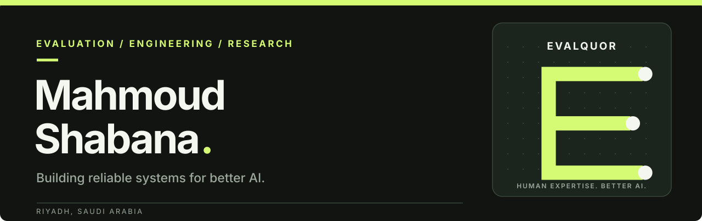
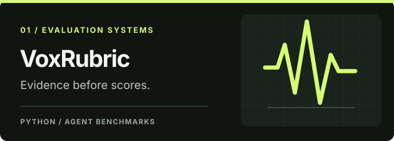
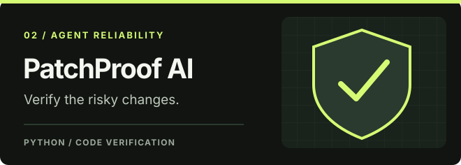
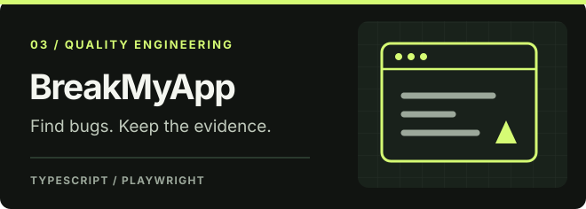
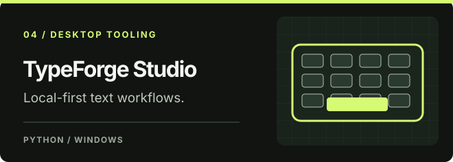

 

**AI EVALUATION** &nbsp; / &nbsp; **AGENTIC SYSTEMS** &nbsp; / &nbsp; **SOFTWARE ENGINEERING**

*Research rigor. Reproducible engineering. Useful open source.*

[**EVALQUOR website**](https://evalquor-website.vercel.app/) &nbsp; · &nbsp; [**Explore repositories**](https://github.com/Mahmoud-Shabana?tab=repositories) &nbsp; · &nbsp; [**Achievements**](https://github.com/Mahmoud-Shabana?tab=achievements)

---

### Building AI systems that can be evaluated, tested and trusted.

I'm **Mahmoud Shabana**, a software engineer and AI evaluation practitioner working at the intersection of **LLM evaluation, agent reliability, reproducible benchmarks, and developer tooling**.

I'm developing **[EVALQUOR](https://evalquor-website.vercel.app/)** around its guiding principle: **Human Expertise. Better AI.** I turn ambiguous technical problems into explicit requirements, measurable tests, inspectable evidence, and tools other engineers can reproduce.

### Selected work

<table>
<tr>
<td width="50%" valign="top">

<strong><a href="https://github.com/Mahmoud-Shabana/voxrubric">VoxRubric</a></strong> · Alpha

Provider-neutral evaluation and regression benchmarking for interview and voice agents, including Arabic/English workflows.

Python · Evaluation · Voice agents
</td>
<td width="50%" valign="top">

<strong><a href="https://github.com/Mahmoud-Shabana/PatchProof-AI-Risk-Adaptive-Verification-for-Coding-Agents">PatchProof AI</a></strong> · Research

Risk-adaptive verification of AI-generated code changes, with reproducible tests and evidence-aware decisions.

Python · Coding agents · Software verification
</td>
</tr>
<tr>
<td width="50%" valign="top">

<strong><a href="https://github.com/Mahmoud-Shabana/breakmyapp">BreakMyApp</a></strong> · Developer preview

Local-first Chromium website QA that detects runtime and responsive issues and saves reviewable evidence.

TypeScript · Playwright · Browser QA
</td>
<td width="50%" valign="top">

<strong><a href="https://github.com/Mahmoud-Shabana/typeforge-studio">TypeForge Studio</a></strong> · Windows-first

A local desktop typing workstation with Unicode handling, profiles, keyboard controls and reusable snippets.

Python · Windows · Desktop tools
</td>
</tr>
</table>

**Systems engineering case study:** [HP ZBook Fury 17 G7 / OpenCore Sequoia](https://github.com/Mahmoud-Shabana/HP-ZBook-Fury-17-G7-OpenCore-Sequoia) — real-hardware findings, reproducible diagnostics, tested workarounds and clearly documented limitations.

> **Project transparency:** Research prototypes, alpha releases and developer previews are labeled as such. Visit each repository for setup instructions, evidence and verified scope.

### Areas of expertise

| AI & evaluation | Engineering & quality | Practical tooling |
| :--- | :--- | :--- |
| LLM evaluation & rubrics | Coding-agent verification | Python / TypeScript |
| Benchmarks & regressions | Test design & automation | Docker / Git / CI |
| Expert-led human review | Reproducibility & evidence | Playwright / Linux / SQL |

### How I work

**Specify the failure mode** → **Build an independent check** → **Run reproducible experiments** → **Document limitations** → **Improve the system.**

---

**HUMAN EXPERTISE. BETTER AI.**

[**Explore EVALQUOR**](https://evalquor-website.vercel.app/) &nbsp; · &nbsp; [**Browse open-source work**](https://github.com/Mahmoud-Shabana?tab=repositories)

Riyadh, Saudi Arabia · Research-driven software engineering

